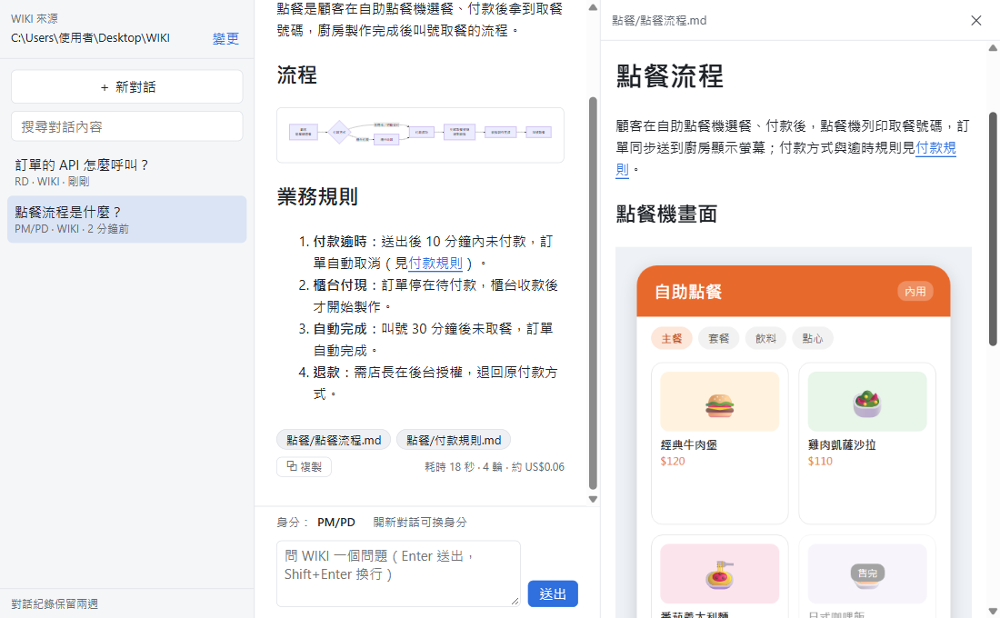
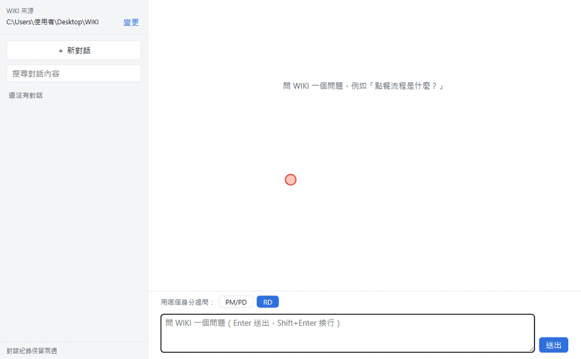
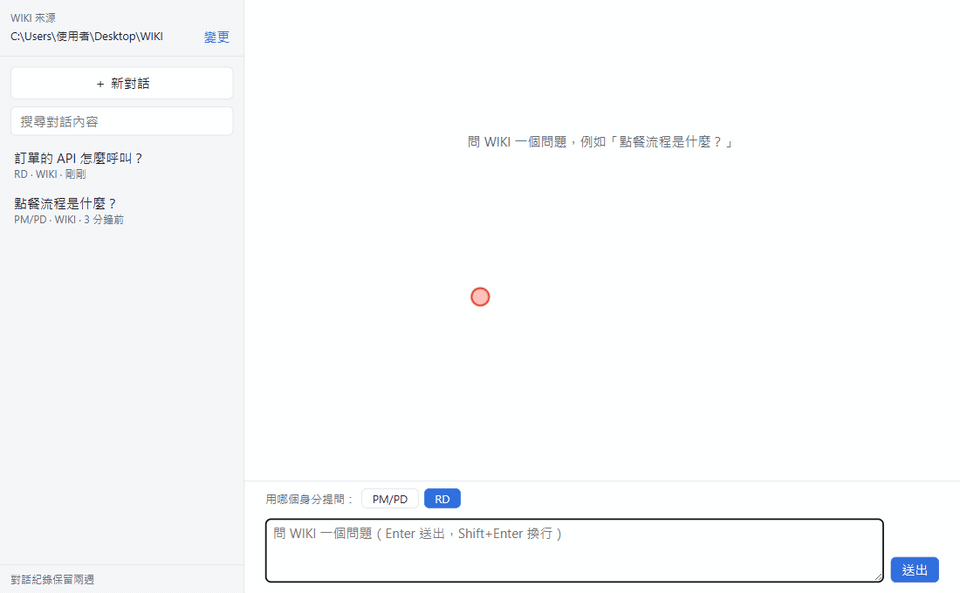
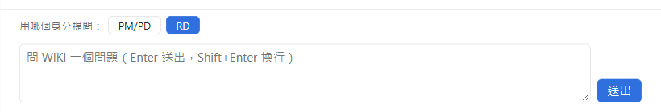
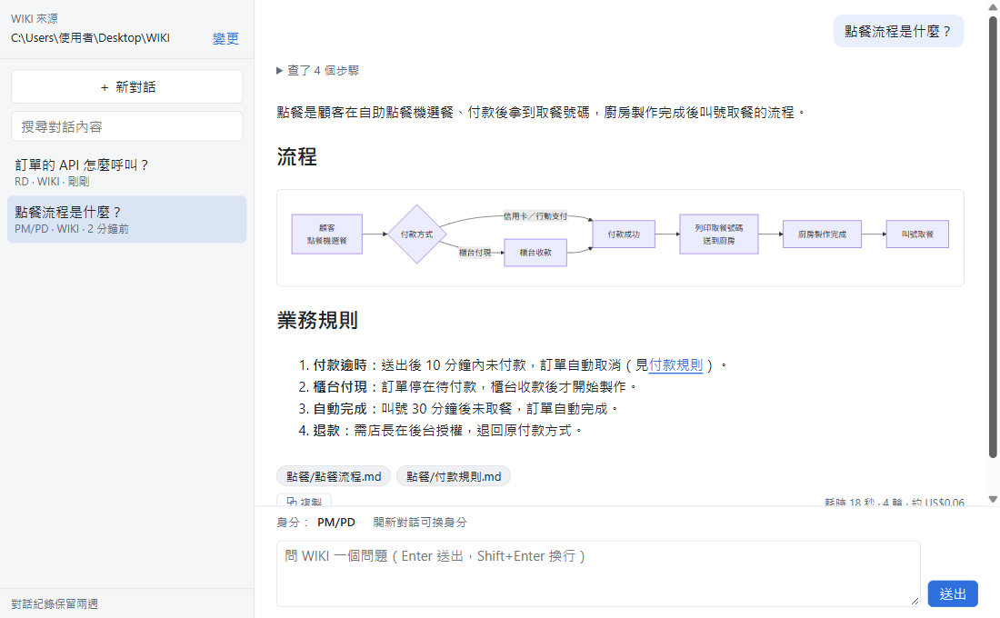
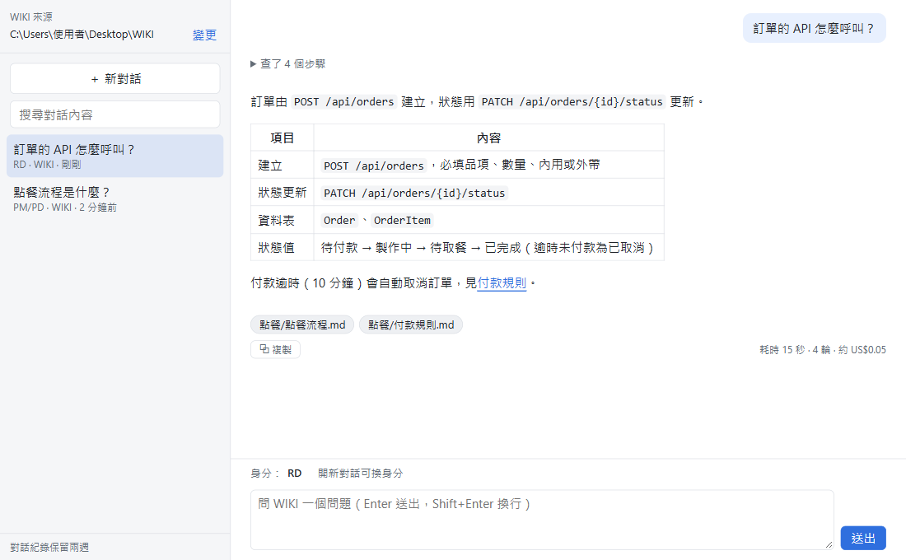
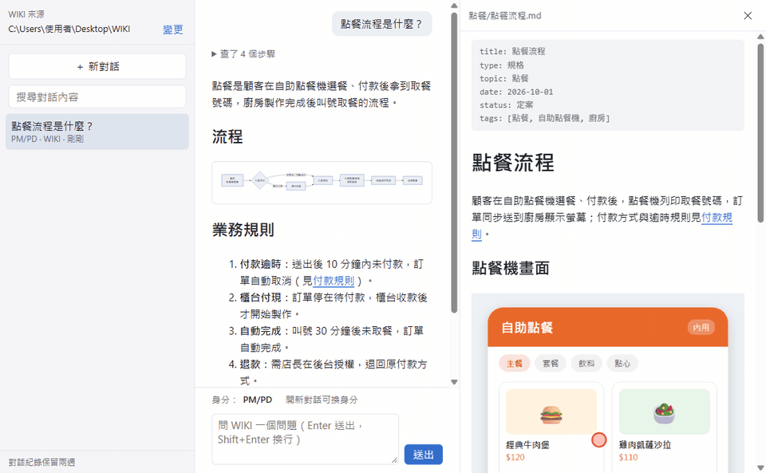
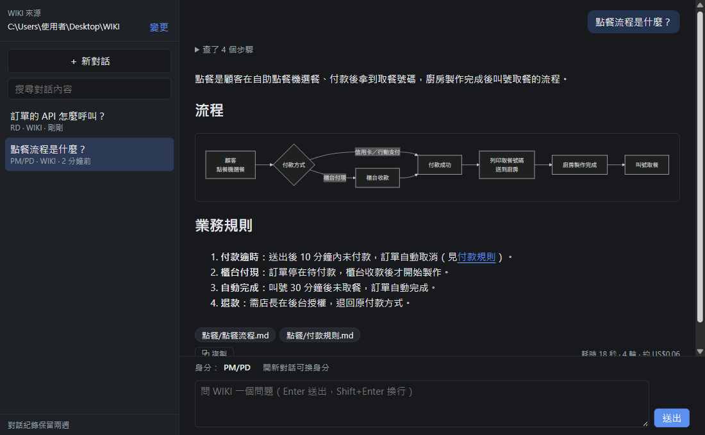

# wiki-ask

用瀏覽器問本機 WIKI 知識庫的聊天介面。由本機已登入的 Claude Code CLI 以受限模式讀 WIKI 回答，回答會附引用文件；可以連續追問，也可以回到兩週內的舊對話繼續聊。



**30 秒看懂怎麼用**：選身分 → 提問 → 邊看 Claude 查了哪些檔、邊看回答一段段出現（流程圖會直接畫出來）→ 點引用標籤在右側預覽原文，文件裡的連結和圖片也能直接看。



> 本 README 的截圖與動畫都是用虛構的示範 WIKI（餐廳自助點餐機）錄的，不是真實資料。重錄方式見 [`docs/README素材錄製.md`](docs/README素材錄製.md)。

設計文件：`docs/superpowers/specs/2026-10-16-wiki-chat-design.md`

---

# 使用說明

## 1. 開啟前要準備的條件

| 條件 | 怎麼確認 | 沒有的話 |
|---|---|---|
| Windows 11 | — | 只支援 Windows |
| Node.js 20 以上 | 開 PowerShell 執行 `node -v`，要顯示 `v20` 以上 | 見 1-1 |
| Claude Code CLI（`claude.exe`） | 執行 `claude --version`，要顯示版本號（例如 `2.1.303 (Claude Code)`） | 見 1-2 |
| Claude CLI 已登入 | 執行 `claude -p "回覆 OK"`，要回 `OK` 之類的文字 | 見 1-3 |
| 本機 WIKI 資料夾 | 資料夾存在，裡面有 `.md` 檔 | 開啟後可在網頁上選擇路徑 |

不需要 `npm install`，本專案沒有任何相依套件。`curl` 是 Windows 11 內建的，不用另外裝。

### 1-1. 安裝 Node.js

二選一：

- 到 <https://nodejs.org/> 下載 **LTS** 版的 Windows 安裝檔（`.msi`），一路下一步。
- 或在 PowerShell 執行：

  ```powershell
  winget install OpenJS.NodeJS.LTS
  ```

裝完後**關掉再重開** PowerShell，執行 `node -v` 確認。

### 1-2. 安裝 Claude Code CLI

在 PowerShell 執行官方安裝指令：

```powershell
irm https://claude.ai/install.ps1 | iex
```

它會裝出 `claude.exe`（通常在 `%USERPROFILE%\.local\bin\`）並加進 PATH。裝完後重開 PowerShell，執行 `claude --version` 確認。

> 用 `npm install -g @anthropic-ai/claude-code` 裝的版本只有 `claude.cmd`，wiki-ask 找不到它。請改用上面的官方安裝方式，或見「常見問題」的「找不到 claude 執行檔」。

### 1-3. 登入 Claude CLI

1. 在 PowerShell 執行 `claude`。
2. 第一次執行會引導你登入：選登入方式，瀏覽器會開登入頁，登入後回到終端機。
3. 看到 Claude 的對話畫面就代表登入成功，輸入 `/exit` 離開。
4. 執行 `claude -p "回覆 OK"` 再確認一次：有回文字就是好了。

登入狀態會一直保留，平常不用重登。如果 wiki-ask 的回答出現「請確認 Claude CLI 已登入」，再回來做一次這一步。

## 2. 開啟

雙擊專案資料夾裡的 **`start.cmd`**，它會：

1. 開一個標題為「wiki-ask daemon」的視窗，在裡面執行 daemon（daemon 已在執行就略過這步）。
2. 等 daemon 就緒後，用預設瀏覽器開 `http://127.0.0.1:7798/#token=...`。

**「wiki-ask daemon」視窗要保持開著**，關掉它服務就停了。它可以最小化。

視窗開頭會印出目前的設定，可以用來檢查：

```
wiki-ask daemon：http://127.0.0.1:7798
token：（一串英數字）
WIKI：C:\Users\...\Desktop\WIKI
claude：C:\Users\...\.local\bin\claude.exe
```

如果 `WIKI：` 後面出現「找不到這個資料夾，請在網頁上變更」，開網頁後在左上角改路徑即可。

之後要再用，再雙擊一次 `start.cmd` 就好；daemon 還在跑的話，它只會幫你開瀏覽器。

## 3. 關閉

在「wiki-ask daemon」視窗按 `Ctrl+C`，或直接關掉該視窗。瀏覽器分頁關不關都沒關係。

## 4. 使用

### 4-1. 設定 WIKI 來源

左上角顯示目前的 WIKI 資料夾。按「變更」可以貼上路徑，或按「瀏覽…」跳出 Windows 的資料夾選擇視窗，選好後按「儲存」。



- 設定會一直保留，直到你再次變更。
- 換路徑只影響**新對話**；舊對話仍然使用它當時的 WIKI。
- 路徑不存在時會顯示錯誤，設定不會被改掉。

### 4-2. 選身分、提問

按「＋ 新對話」，先在輸入框上方選**用哪個身分提問**，再輸入問題，按 `Enter` 或「送出」（`Shift+Enter` 換行）。



同一個問題，不同身分會得到重點不同的回答：

| PM/PD：流程架構與業務規則 | RD：實作細節 |
|---|---|
|  |  |
| 先講整體在做什麼，再用流程圖、編號步驟說明誰在什麼條件下做什麼，以及業務規則與例外。程式名稱只在必要時帶一句。 | 直接講 API、資料表與欄位、狀態值、程式位置與技術限制。 |

- 預設帶上次選的身分。
- 送出第一個問題後，這個對話的身分就**固定**了（輸入框上方會顯示「身分：PM/PD」）；要換身分請開新對話。
- 左側對話清單會標示每個對話的身分。舊版建立、沒有身分的對話一律視為 RD。
- 各身分的定義寫在 [`daemon/prompts/agent.md`](daemon/prompts/agent.md)，改完要**重啟 daemon** 才會生效。
- 身分清單只定義在 [`daemon/roles.js`](daemon/roles.js) 的 `ROLES`；網頁啟動時向 daemon 的 `/roles` 取得，不用另外改前端。新增身分時，`agent.md` 也要有對應的「## 名稱」段落。

### 4-3. 看回答

- **查了 N 個步驟**：回答時會即時列出 Claude 搜尋、讀了哪些檔，以及它查找前說明的打算（💬 開頭）；回答完成後收合，點開可以再看。
- **逐字顯示**：回答文字會一段段即時出現；「思考中…」旁會顯示已經等了多久。
- **流程圖**：Claude 用 Mermaid 畫的流程圖、時序圖會直接顯示成圖。語法有錯的圖會保留原始文字。
- **引用標籤**：回答下方的「上一層資料夾/檔名」標籤，**單擊**在右側開預覽欄（front matter 會顯示成中繼資料區塊），**雙擊**用預設程式開啟該 `.md` 檔。
- **在預覽欄瀏覽 WIKI**：預覽文件裡的 WIKI 連結（藍色底線）可以直接點，會在預覽欄換成那份文件；左上角「←」回上一份。

  

  - `.md` 連結：開那份文件，`文件.md#某一節` 會捲到那一節。
  - `#某一節`：在同一份文件裡捲過去（照 GitHub 的標題錨點規則比對）。
  - 資料夾連結（結尾是 `/`）：開該資料夾的 `index.md`，沒有的話會提示。
  - `http(s)` 網址：開新分頁。html、pdf 等其他檔案只顯示成文字。
  - 回答裡的 WIKI 連結也能點，會在預覽欄打開。
- **圖片**：預覽文件裡的 WIKI 圖片（png、jpg、gif、webp）會直接顯示；外部網址的圖片不會載入，改成一個「🖼 外部圖片」連結，點了開新分頁看。
  - 路徑有空白或括號的圖片（例如 `.attachments/簡報 (內部用)/a.png`）也能顯示。
  - 從 Word 轉檔、圖片被截斷成 `data:image/png;base64...` 的文件：原位置顯示「這張圖在轉檔時被截斷了」，文末另列「本文附圖」，內容是同名附件資料夾 `.attachments/<文件名>/` 裡的圖檔。附圖依檔名排序，**不一定對應文中的位置**。
  - 引用的圖片不在 WIKI 裡（例如從 Azure DevOps wiki 匯出的 `/.attachments/…`、沒一起複製的 `./images/…`）：顯示「原圖沒有匯入 WIKI：檔名」。
  - 回答的引用標籤如果是圖檔，單擊會在預覽欄顯示那張圖，雙擊用預設的看圖程式開啟。
- **追問**：在同一個對話繼續輸入，Claude 會記得前面問過什麼。
- **停止**：回答進行中可以按「停止」中斷。
- **耗時與成本**：回答下方右側會小字顯示「耗時 · 輪數 · 約 US$金額」。金額是 Claude CLI 依 API 定價估算的參考值；用訂閱方案登入時不一定實際計費。
- **複製**：回答下方的「⧉ 複製」會把回答以 Markdown 複製到剪貼簿，可以直接貼進文件。
- **重新提問**：最後一題失敗、逾時、被停止或因 daemon 中斷沒回完時，會出現「↻ 重新提問」，按了就用同一個問題再問一次。

Claude 只會根據 WIKI 內容回答；WIKI 裡找不到時，會回「WIKI 沒有這份資料」並列出它搜尋過的關鍵字。

### 4-4. 管理對話

- **刪除對話**：滑鼠移到左側對話上，按垃圾桶，再按一次「確定刪除？」才會真的刪掉（3 秒內沒按就取消）。

  

- **保留期限**：以最後更新時間起算，超過兩週的對話會自動刪除，清單也只顯示兩週內的對話。
- **搜尋**：「＋ 新對話」下方的搜尋框會比對對話標題和所有問答內容。
- **回答中**：還在回答的對話，清單上會標「● 回答中」；切到別的對話時它會在背景繼續回答。

### 4-5. 深色模式

跟著 Windows 的淺色／深色設定，流程圖也會一起換成深色。



## 5. 常見問題

| 狀況 | 原因與處理 |
|---|---|
| 雙擊 `start.cmd` 出現「找不到 node，請先安裝 Node.js 20 以上。」 | 沒裝 Node.js，或裝完沒重開視窗。見 1-1。 |
| 出現「等待 daemon 逾時，請查看 daemon 視窗的錯誤訊息。」 | 看 daemon 視窗。常見是 `EADDRINUSE`（7798 port 被別的程式占用），可以改 port，見「環境變數」。 |
| 回答出現「找不到 claude 執行檔：claude」 | PATH 上沒有 `claude.exe`。照 1-2 用官方方式安裝；或把環境變數 `WIKICHAT_CLAUDE` 設成 `claude.exe` 的完整路徑，再重開 daemon。 |
| 回答出現「Claude 執行失敗（退出代碼 N）。請確認 Claude CLI 已登入。」 | 登入過期或沒登入。見 1-3。後面附的錯誤文字也可以參考。 |
| 回答出現「查了 40 輪還沒找到結論，已停止。」 | Claude 查找的輪數到了上限（預設 40）。把問題問得更具體、或指定資料夾再問；真的需要更多輪，可以調高 `WIKICHAT_MAX_TURNS`。 |
| 回答出現「回答逾時，請稍後重試。」 | 單次回答超過 10 分鐘。把問題問得具體一點再試。 |
| 網頁上方要求「請貼上 token」 | 你是手動開網址，沒有經過 `start.cmd`。用 `start.cmd` 開，或打開 `%USERPROFILE%\.wikichat\token`，把內容貼上。 |
| 出現「這個對話的 WIKI 路徑已不存在」 | 這個舊對話當時用的 WIKI 資料夾被搬走或改名了。可以看舊內容，但不能再追問；請開新對話。 |
| 出現「上一個問題還在回答中」 | 同一個對話一次只能問一題，等它回完或按「停止」。 |
| 網頁打不開（連線被拒） | daemon 沒在跑。雙擊 `start.cmd`。 |
| 流程圖變成一堆黑色色塊、字擠在一起 | daemon 是更新程式前啟動的，還在送舊的安全設定，擋掉了圖的樣式。關掉 daemon 視窗、重新執行 `start.cmd`，再按 `Ctrl+F5`。 |
| 更新程式後畫面沒變 | 瀏覽器用了快取。按 `Ctrl+F5` 強制重新整理；改到 daemon 的部分（例如 `agent.md`）則要重啟 daemon。 |

---

# 技術細節

## 環境變數

要長期生效，用 `setx 變數 值` 設定，再重開 `start.cmd`。

| 變數 | 預設值 | 說明 |
|---|---|---|
| `WIKICHAT_PORT` | `7798` | daemon port（只綁 127.0.0.1） |
| `WIKICHAT_CONFIG_DIR` | `%USERPROFILE%\.wikichat` | token、設定、對話紀錄的存放位置 |
| `WIKICHAT_WIKI_DIR` | `%USERPROFILE%\Desktop\WIKI` | 還沒在網頁上選過 WIKI 時的初始路徑 |
| `WIKICHAT_CLAUDE` | `claude` | claude 執行檔；以 `.js` 結尾時會用 node 執行（測試用） |
| `WIKICHAT_RETENTION_DAYS` | `14` | 對話保留天數 |
| `WIKICHAT_MAX_TURNS` | `40` | 每個問題 Claude 最多查幾輪（`--max-turns`），避免一直搜尋停不下來 |

## 資料存放

```
%USERPROFILE%\.wikichat\
  token                 API token（32 bytes 隨機）
  settings.json         目前的 WIKI 路徑
  conversations\<id>.json   一個對話一個檔
```

網頁會把 token 存在瀏覽器裡，並從網址列清掉。

Claude 自己的 session 檔（`~/.claude/projects/<WIKI 路徑編碼>/<對話 id>.jsonl`，有時還有同名資料夾）用來讓追問記得上下文。wiki-ask 刪除對話、或清除超過保留期限的對話時，會一併刪掉該對話 id 的 session 檔，所以不會超過兩週還留著。只會刪 wiki-ask 自己對話的 id；你在 WIKI 資料夾直接用 Claude Code 開的 session 不受影響。設了 `CLAUDE_CONFIG_DIR` 時改到該資料夾的 `projects\` 找。

> 這個清除機制加入前就已經被清掉的對話，wiki-ask 不知道它們的 id，所以對應的舊 session 檔不會自動刪；需要的話請手動整理。

## 安全邊界

- daemon 只 listen `127.0.0.1`，而且會檢查 `Host` header；除了 `/health` 和靜態頁，其他 API 都要帶 `X-WikiChat-Token`。
- 預覽只接受 WIKI 內的 `.md` 檔，開檔另外接受 png、jpg、gif、webp：`..`、絕對路徑，以及指向 WIKI 外的 junction/symlink 都會被拒絕。
- 預覽裡的圖片走 `/wiki/asset`，文末附圖清單走 `/wiki/attachments`（只回檔名），規則同上，而且只回 png、jpg、gif、webp（不收 SVG，因為它可以夾帶程式碼）。網頁帶 token 抓圖、轉成 `blob:` 網址顯示，所以 CSP 的 `img-src` 只多開了 `blob:`，外部圖片仍然擋掉。
- Claude 的執行參數是：

  ```
  claude -p --output-format stream-json --verbose --max-turns 40
    --restricted --tools Read,Grep,Glob
    --allowedTools Read Grep Glob --permission-mode dontAsk
    --include-partial-messages --strict-mcp-config --append-system-prompt-file %USERPROFILE%\.wikichat\prompts\<身分>.md
    --session-id <id>   （追問改用 --resume <id>）
  ```

  工作目錄（cwd）是該對話的 WIKI 資料夾，問題從 stdin 傳入。`<身分>.md` 是 daemon 啟動時把 `daemon/prompts/system.md`（共用回答規則）接上 `daemon/prompts/agent.md` 裡該身分的段落產生的。

### CLI 實測（Claude Code 2.1.303，2026-10-19）

在真的 WIKI 目錄，用上面的參數直接跑 `claude`（不經過 daemon）：

| 測試 | 結果 |
|---|---|
| 要求讀 `C:/Windows/win.ini` | init 事件的工具清單只有 `Glob, Grep, Read`，MCP 清單為空。Read 呼叫被拒絕：`C:\Windows\win.ini is outside C:\Users\<使用者>\Desktop\WIKI ... --restricted confines the file tools to the working directory.` |
| 要求執行 `dir` | 沒有可以執行 shell 的工具，Claude 改用 Glob 列出檔案 |
| 用 `--resume` 問「我剛剛問了什麼」 | 正確重述上一題，代表上下文有保留 |

結論：`--restricted` 本身就會忽略 user/project/local 設定檔，所以不需要 `--setting-sources ""`；MCP 則是由 `--strict-mcp-config` 關掉。

## 開發

```
cd daemon && node --test
cd web && node --test
```

用假的 Claude 手動測介面（不會呼叫真的 CLI）：

```powershell
$env:WIKICHAT_CLAUDE = "$PWD\daemon\fixtures\fake-claude.js"
$env:FAKE_CLAUDE_MODE = "partial"   # partial（模擬逐字串流）/ ok / nosources / badsources / fail / hang / maxturns / args
$env:FAKE_CLAUDE_DELAY_MS = "800"   # 選用：每行輸出間隔，方便在瀏覽器看串流過程
$env:WIKICHAT_CONFIG_DIR = "$env:TEMP\wikichat-dev"
$env:WIKICHAT_PORT = "7899"
node daemon\server.js
```

---

## 授權

[MIT](LICENSE)
