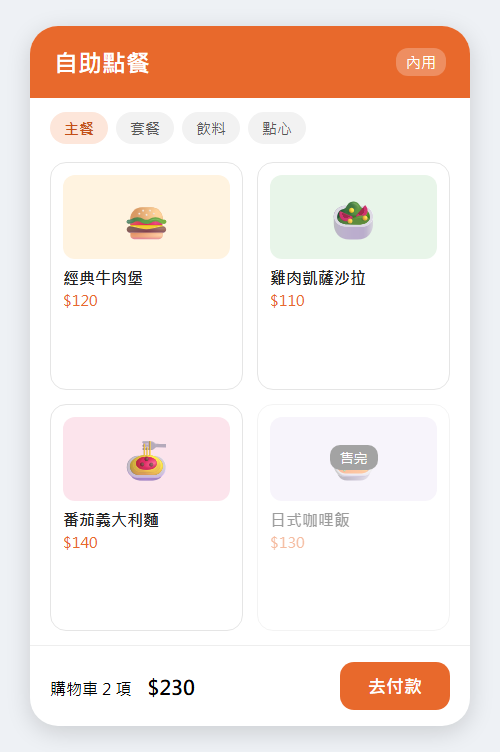

# 點餐流程

顧客在自助點餐機選餐、付款後，點餐機列印取餐號碼，訂單同步送到廚房顯示螢幕；付款方式與逾時規則見[付款規則](付款規則.md)。

## 點餐機畫面

訂單送出後的狀態變化見[狀態](#狀態)。

## 狀態

| 狀態 | 說明 |
|---|---|
| 待付款 | 顧客已送出餐點，還沒付款 |
| 製作中 | 付款成功，廚房開始製作 |
| 待取餐 | 廚房完成，叫號螢幕顯示取餐號碼 |
| 已完成 | 顧客取餐，或叫號 30 分鐘後自動完成 |
| 已取消 | 10 分鐘內未付款自動取消 |

## API

- `POST /api/orders`：建立訂單（必填：品項、數量、內用或外帶）
- `PATCH /api/orders/{id}/status`：更新狀態
- 資料表：`Order`、`OrderItem`
